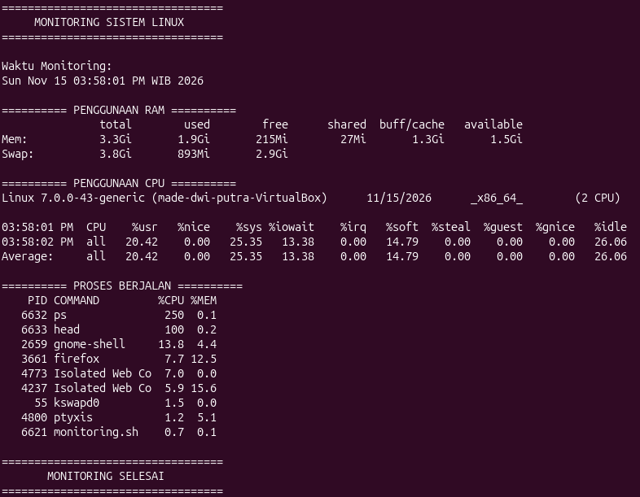

# PORTOFOLIO ANGGOTA 5

## 1. Identitas
- Nama: Made Dwi Putra
- NIM: 2510512204
- Username GitHub: madedwi1102
- Anggota: 5
- Proyek: Sistem Antrean Pekerjaan dan Monitoring Proses Linux

## 2. Tanggung Jawab
Bertanggung jawab pada bagian monitoring sistem Linux, pengaturan hak akses pengguna, dokumentasi, dan pengujian Docker.

## 3. Kontribusi Pengerjaan

### A. Monitoring Sistem Linux
Pembuatan script `monitoring/monitoring.sh` untuk memantau penggunaan CPU, RAM, dan proses yang sedang berjalan. Hasil monitoring ditampilkan di terminal dan disimpan secara otomatis ke `output/monitoring.log`.

**Bukti Monitoring RAM**

**Bukti Monitoring CPU**

**Bukti Monitoring Proses**

**Bukti Monitoring Otomatis**

### B. Pengaturan Hak Akses
Pengaturan hak akses menggunakan group `kelompok_proyek`. Pengujian dilakukan dengan dua akun berbeda:
- `anggota1` berhasil mengakses direktori proyek.
- `tamu` ditolak karena tidak memiliki izin akses.

**Bukti Pengujian Akses Positif**

**Bukti Pengujian Akses Negatif**

### C. Pengujian Beban CPU
Pengujian beban CPU menggunakan `stress-ng` dengan metode `loop`. Hasil pengujian berhasil dan aktivitas CPU dapat diamati melalui script monitoring.

**Bukti Pengujian Beban CPU**

### D. Pengujian Docker
Instalasi Docker Engine versi `29.1.3` dan penggunaan image Alpine versi `3.22`.

Pengujian dilakukan melalui dua skenario:
- **Pengujian positif:** Container berhasil membaca file `output/laporan.txt` menggunakan bind mount read-only.
- **Pengujian negatif:** Container tidak dapat menulis ke file karena sistem menolak akses dengan pesan `Read-only file system`.

Verifikasi checksum dilakukan sebelum dan sesudah pengujian. Hasilnya sama, sehingga file laporan pada host tetap tidak berubah.

Bukti pengujian Docker dicatat dalam `docs/pengujian-docker-anggota5.md`.

## 4. Bukti Pekerjaan
File hasil pengerjaan yang terdapat di repository:
- `monitoring/monitoring.sh`
- `output/monitoring.log`
- `output/laporan.txt`
- `docs/kontribusi-anggota5.md`
- `docs/pengujian-docker-anggota5.md`

Commit terkait:
- `da46bbe` – Menambahkan monitoring otomatis dan log sistem.
- `39d4d5a` – Menambahkan pengujian Docker read-only anggota 5.

## 5. Konsep Sistem Operasi
- **Process Management:** Pemantauan proses yang berjalan di Linux.
- **CPU Management:** Pemantauan penggunaan CPU dan pengujian beban.
- **Memory Management:** Pemantauan penggunaan RAM.
- **Protection and Security:** Pengaturan hak akses menggunakan user, group, dan permission.
- **Virtualisasi:** Penggunaan Docker container dengan pembatasan akses file.

## 6. Kendala dan Solusi
Pada pengaturan hak akses, akses akun `tamu` ditolak karena tidak memiliki izin. Hal tersebut sesuai dengan tujuan pengujian pembatasan akses.

Pada pengujian Docker, penulisan file ditolak karena direktori menggunakan opsi read-only. Hasil tersebut menunjukkan bahwa pembatasan penulisan berjalan sesuai konfigurasi.

Pengujian awal `stress-ng` mengalami kendala, kemudian berhasil dijalankan menggunakan metode `loop`.

## 7. Refleksi
Pengerjaan bagian ini menunjukkan bagaimana monitoring dapat digunakan untuk melihat penggunaan sumber daya Linux. Pengaturan permission membantu membatasi akses pengguna, sedangkan Docker read-only dapat mencegah perubahan file dari dalam container.

## 8. Status Pengerjaan
Bagian monitoring, pengaturan hak akses, dokumentasi, dan pengujian Docker telah diselesaikan. Integrasi dengan sistem antrean utama serta pembuatan laporan otomatis dari sistem masih menunggu penggabungan hasil pekerjaan anggota kelompok lainnya.
